# ASCII Wallpaper

Animated ASCII-art live wallpapers for Windows, drawn behind your desktop icons.

It has 32 scenes: 16 glowing ones for dark mode and 16 ink-on-paper ones for an off-white light mode. You control it from a tray icon. It's plain Python with no dependencies and uses very little CPU.

<p>
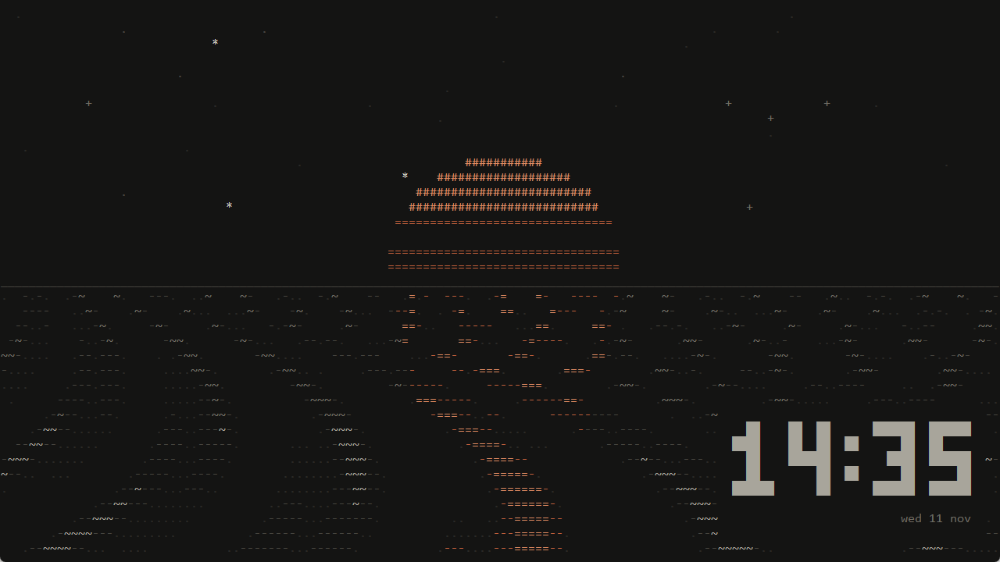
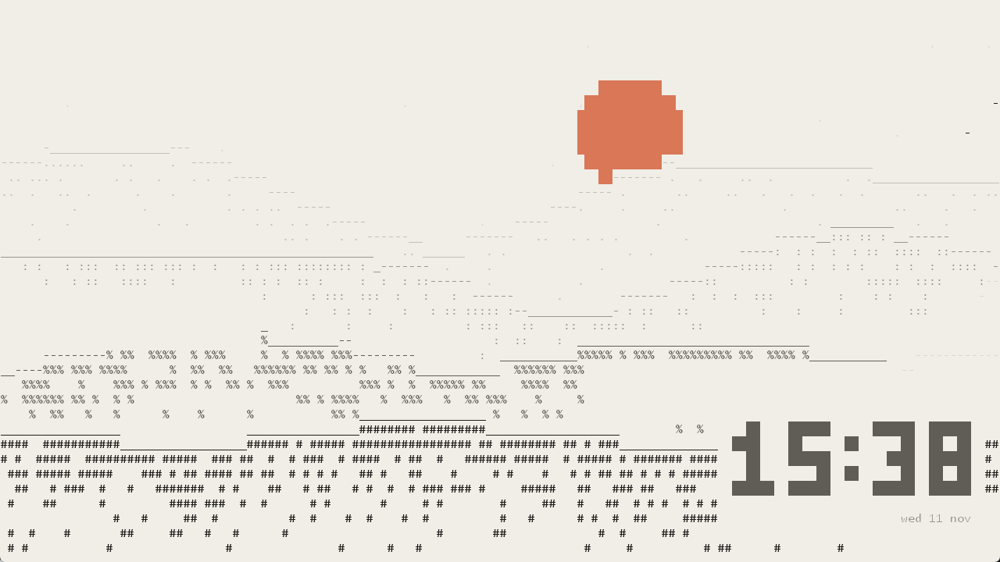
</p>

## Scenes

**Dark mode**

| | | |
|---|---|---|
| Rain | Night | Waves |
| Glow Tide | Swell | Aurora |
| Ribbons | Campfire | Plasma |
| Donut | Black Hole | Galaxy |
| Warp | Planet | Slipknot* |
| Megadeth* | | |

**Light mode (off-white)**

| | | |
|---|---|---|
| Ink Mountains | Koi Pond | Topographic |
| Zen Garden | Orrery | Blossoms |
| Lighthouse | Typewriter | Star Chart |
| Vines | Weather Map | Gears |
| Seismograph | Marbling | Spirograph |
| Maze | | |

<p>
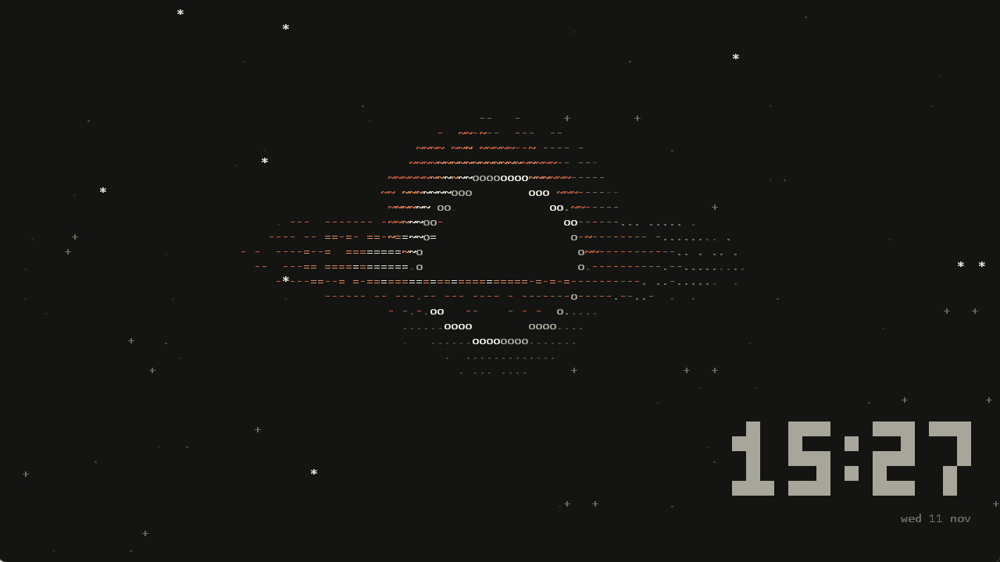
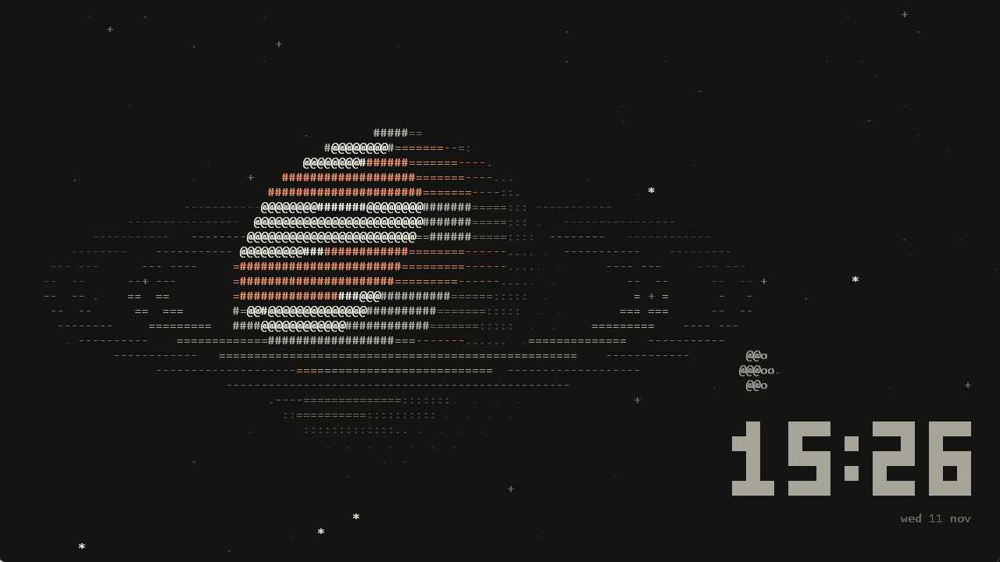
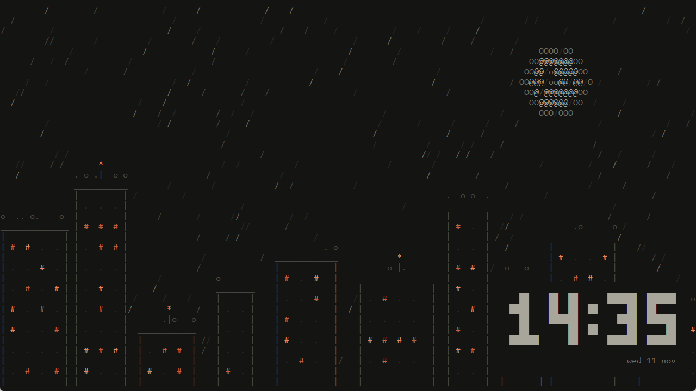
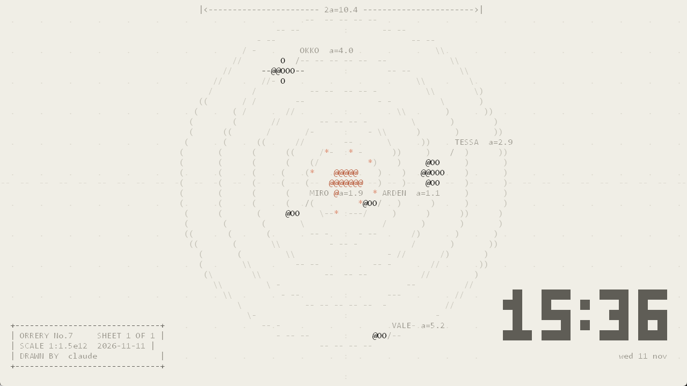
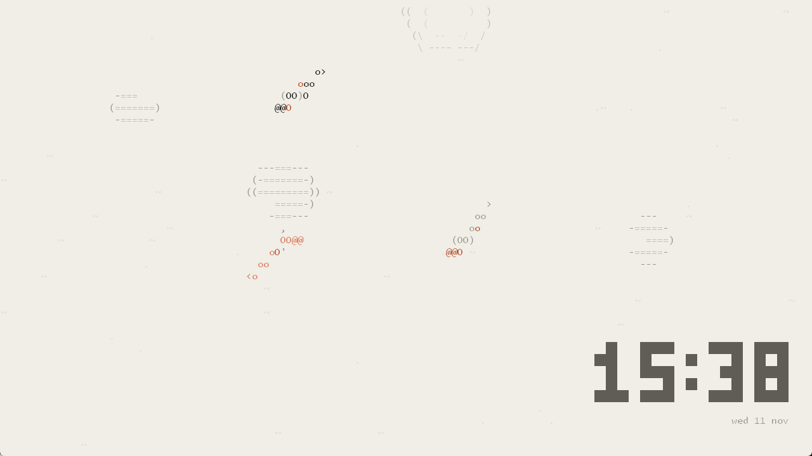
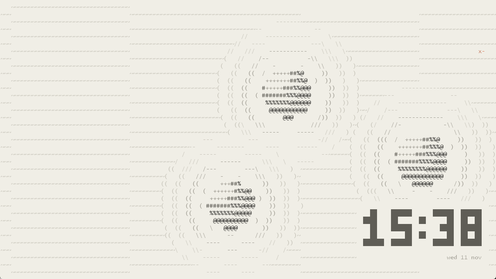
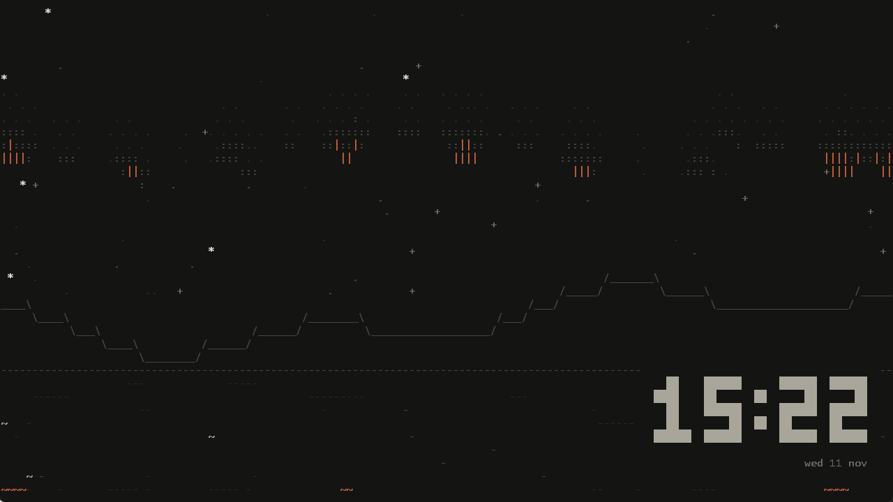
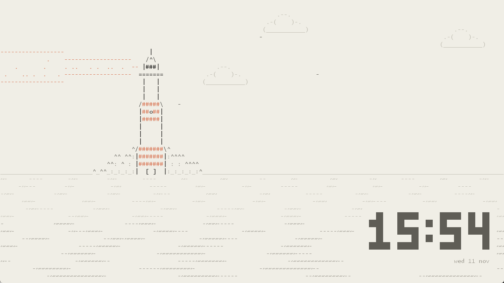
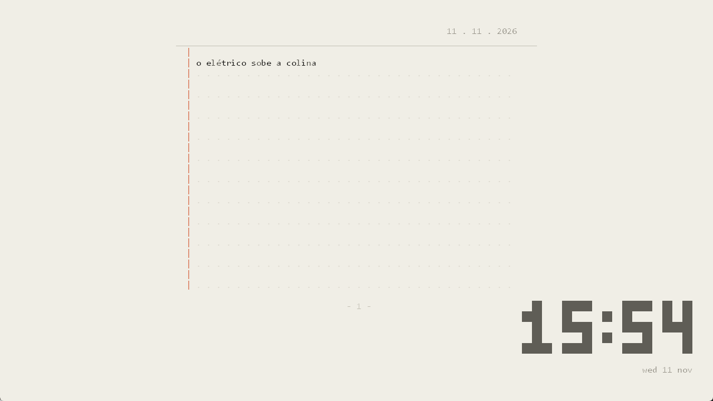
</p>

\* Fan-made scenes with the band names in the project's own block lettering. They're not affiliated with the bands and don't use their logos or artwork.

## Requirements

- Windows 10 or 11 (also works with the new desktop layout in 24H2 and later)
- [Python](https://www.python.org/downloads/) 3.9 or newer, with "Add python.exe to PATH" ticked during install

Nothing else needs installing; it uses only the Python standard library.

## Install

```powershell
git clone https://github.com/ajr-alves/ascii-wallpaper.git
cd ascii-wallpaper
powershell -ExecutionPolicy Bypass -File install.ps1
```

`install.ps1` starts the wallpaper and adds it to startup, so it runs every time you log in.

To remove it, run `powershell -ExecutionPolicy Bypass -File uninstall.ps1`. That stops the wallpaper and removes it from startup, and your normal wallpaper comes back.

## Using it

Click the **~** icon in the taskbar's hidden-icons area (the **^** arrow next to the clock) to:

- turn the wallpaper on or off, or skip to the next scene
- stop or resume the rotation ("Rotate scenes"; turning it off keeps the current scene)
- pick a scene, or choose which scenes rotate and how often (1–60 minutes)
- change the colour theme: Claude, Amber, Matrix, Ice, Sakura or Mono
- switch the appearance between dark and light (off-white); each mode has its own scenes
- show or hide the big clock
- show a **system stats** panel in the corner of your choice (see below)
- make the **taskbar** follow the dark/light appearance, or auto-hide it so the wallpaper fills the screen
- turn "start with Windows" on or off, or quit

### System stats

An ASCII panel with meters for CPU, memory, GPU, VRAM and disk, the network speed, and a history graph of CPU and GPU load. On NVIDIA cards it also shows the GPU temperature and power draw, read through `nvidia-smi`, which comes with the driver. Windows doesn't let normal programs read the CPU temperature, so the panel doesn't show it. Under "Show on" you choose where it appears: every monitor, or Monitor 1, Monitor 2 and so on, numbered left to right. Until you choose, it shows on your main monitor. Readings are taken once a second in the background and cost well under 1% of one core.

```
+-[ system ]-------------------------------+
| CPU  [|||||||||                     27%] |
| MEM  [||||||||||||||||||    16.8G/31.4G] |
| GPU  [|||                       9%  41C] |
| VRAM [||||                   1.6G/11.9G] |
| DISK [|                              3%] |
| NET  v 1.1M/s    ^ 137K/s                |
|                                          |
|     ..::...               _.....::...--- |
| :::::::::::::..::.._..:::.:::::::::::::: |
| cpu :  gpu -              31W  up 3h 12m |
+-----------------------------[ RTX 5070 ]-+
```

### Taskbar

Windows 11 doesn't let apps make the taskbar fully transparent any more; tools that do it inject code into Explorer. Instead, "Match appearance" switches the taskbar between dark and light to follow the wallpaper mode, and puts your own setting back when you turn it off or quit. "Auto-hide" is the normal Windows auto-hide setting, so the wallpaper uses the full screen.

Each monitor gets its own scene. A monitor stops drawing while a maximized or fullscreen app covers it.

### Command line

| Command | What it does |
|---|---|
| `pythonw ascii_wallpaper.pyw` | Start, or restart if it's already running |
| `pythonw ascii_wallpaper.pyw --stop` | Stop |
| `python ascii_wallpaper.pyw --preview --scene orrery --light` | Try a scene in a normal window |

### Settings

The tray menu saves your choices to `config.json` next to the script. You can also edit that file by hand, and changes apply within a second.

| Key | Values |
|---|---|
| `mode` | `dark` or `light` |
| `scene` / `scene_light` | `cycle`, or a scene name for that mode (`rain`, `blackhole`, `orrery`, ...) |
| `cycle_scenes` / `cycle_scenes_light` | which scenes the rotation uses in each mode |
| `cycle_minutes` | how long each scene stays on |
| `theme` | `claude`, `amber`, `matrix`, `ice`, `sakura`, `mono`, or your own: `{"bg": "#141413", "ramp": [5 colours, dim to bright], "accent": ["#c15f3c", "#e08a62"], "light": {...same keys for light mode...}}` |
| `fps` | frames per second (default 15) |
| `font` / `font_size` | any installed monospace font; size in points at 100% scaling |
| `clock`, `clock_position`, `clock_24h` | the big clock; position is `bottom-right`, `bottom-left`, `top-right` or `center` |
| `pause_when_fullscreen` | stop drawing behind maximized or fullscreen apps |
| `stats` | `off`, `top-left`, `top-right`, `bottom-left` or `bottom-right` |
| `stats_monitor` | `all`, `primary`, or a monitor's device name such as `\\.\DISPLAY2` (easiest to set from the menu) |
| `taskbar_match` | `true` to make the taskbar follow the dark/light mode |

## Making your own scenes

A scene is a small Python class that draws characters into a grid every frame:

```python
class Fireflies(Scene):
    """Fireflies drifting in the dark."""

    def setup(self):
        self.flies = [[self.rng.uniform(0, self.cols), self.rng.uniform(0, self.rows),
                       self.rng.uniform(0, TAU)] for _ in range(40)]

    def frame(self, g, t, dt):
        for x, y, ph in self.flies:
            glow = math.sin(t * 2 + ph)
            if glow > 0.3:
                g.put(int(x + math.sin(t * 0.3 + ph) * 5), int(y), "*", "7" if glow > 0.8 else "6")
```

`g.put(x, y, char, level)` draws one cell. The level picks the colour from the current theme: `'1'`–`'5'` go from faint to strong, and `'6'`/`'7'` are the accent colour. A cell is about 2.1 times taller than it is wide (`self.aspect`).

Add your class to the `SCENES` dict at the bottom of [scenes.py](scenes.py) for dark mode, or [light_scenes.py](light_scenes.py) for light mode. It then shows up in the tray menu.

[docs/SCENE_PROMPT.md](docs/SCENE_PROMPT.md) is a ready-made prompt for designing scenes with Claude. It explains the whole API and asks for an HTML preview you can iterate on in the chat, plus the Python class to paste in.

## How it works

- **Behind the icons:** Windows draws the wallpaper and the desktop icons in separate windows. The program asks Explorer to split them (the `0x052C` message to `Progman`). It then puts one window per monitor between them, so the icons stay on top. On Windows 11 24H2 and later the layout is different, and it handles that too. See [desktop.py](desktop.py).
- **Drawing:** each frame, the active scene fills a character grid. The program draws it with GDI, grouping characters of the same colour into single text calls, and copies it to the screen. Scenes take a few milliseconds per frame.
- **Recovery:** if Explorer restarts or your monitors change, it rebuilds itself. When it exits, it repaints your normal wallpaper.

Inspired by the ASCII visuals of Anthropic's Claude FM lo-fi stream.

## License

[MIT](LICENSE)
